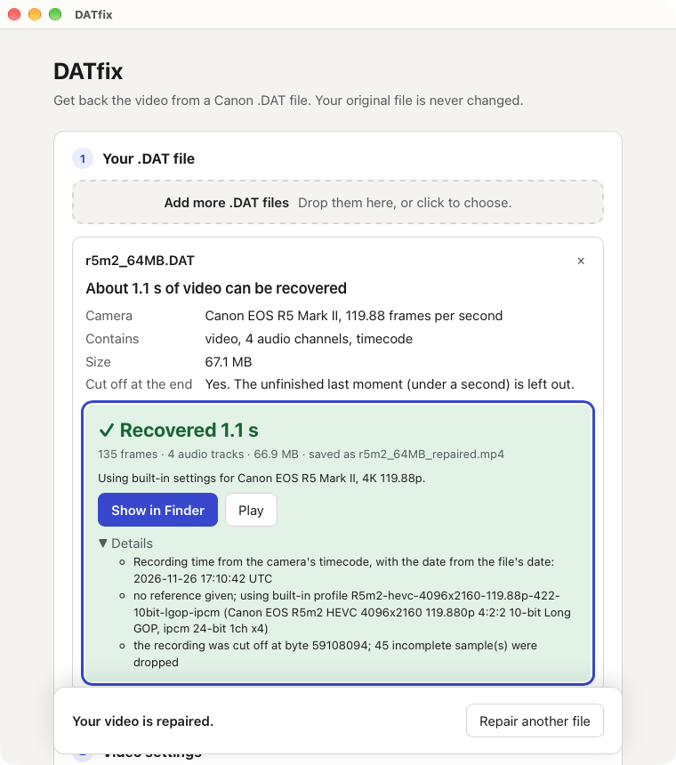

# DATfix

**Get your video back from a Canon `.DAT` file.** DATfix is a free, open-source desktop app and
command-line tool for macOS and Windows. It turns the `.DAT` file that a Canon camera leaves on the
card into an MP4 you can play and edit.

A Canon camera records into a temporary `.DAT` file. When you stop recording, the camera writes the
file's index and renames it to `.MP4`. If the battery dies, the card fails or the camera shows an
error (for example Err 70), the camera never writes that index. Your video is still in the `.DAT`,
but no player or editor can open it.

DATfix rebuilds the missing index from the recovery data that Canon writes inside the `.DAT`. It
copies the video and audio unchanged, with no re-encoding and no quality loss. It runs on your
computer, uploads nothing, and never changes the original file.

## Download

[Download the latest release](https://github.com/lelanddutcher/dat-file-repair/releases/latest).

| You have | Download |
|---|---|
| Mac (Apple silicon or Intel) | `DATfix_<version>_macos_universal.dmg` |
| Windows 10 or 11 (64-bit) | `DATfix_<version>_windows_x64-setup.exe` |
| Command line, Mac (Apple silicon) | `datfix-cli-<version>-aarch64-apple-darwin.tar.gz` |
| Command line, Mac (Intel) | `datfix-cli-<version>-x86_64-apple-darwin.tar.gz` |
| Command line, Windows | `datfix-cli-<version>-x86_64-pc-windows-msvc.zip` |

`SHA256SUMS.txt` lists a checksum for each file.

- **macOS:** the app is signed with a Developer ID and notarized by Apple, so it opens normally.
- **Windows:** the installer is not code-signed yet. SmartScreen may warn about an unknown
  publisher. Choose **More info**, then **Run anyway**. It is tested on Windows 11.

## Is it free?

Yes. DATfix is free for any use, with no trial, watermark or file-size limit. The code is under
the [MIT license](LICENSE).

## Supported cameras

**Verified** means a real `.DAT` from that camera and mode was repaired and passed every check:
the frame count matches the index, ffmpeg decodes the whole file with no errors, audio and video
have the same length, and frames from the middle and end look right.

| Camera | Recording mode | Status |
|---|---|---|
| EOS R5 Mark II | XF-HEVC S, 4K DCI 119.88p, 4:2:2 10-bit, 4 channels 24-bit PCM | Verified |
| EOS R5 | HEVC 4K DCI 59.94p All-I, 4:2:2 10-bit, stereo PCM | Verified |
| EOS R3 | HEVC 4K DCI 29.97p All-I, 4:2:2 10-bit, no audio | Verified |
| EOS R3 | HEVC 4K DCI 59.94p All-I, 4:2:2 10-bit, stereo PCM | Verified |
| EOS R5 Mark II | Other XF-HEVC S frame rates (for example 59.94p) | Expected |
| EOS R5, R6, R6 Mark II | Modes with AAC audio | Expected |
| EOS R6 Mark II | HEVC with PCM audio | Expected |
| Cinema EOS C70, C80 | HEVC with AAC or PCM audio | Expected |
| EOS R, EOS M50 Mark II | Any | Not supported |
| Any | Cinema RAW Light (`.CRM`) | Not supported |

**Expected** means the camera writes the same recovery data. We know the layout from healthy clips,
but have not yet repaired a real `.DAT` from it. If you have one, please
[send a sample](https://github.com/lelanddutcher/dat-file-repair/issues/new/choose).

**Not supported:** the EOS R and M50 Mark II write no recovery index into the `.DAT`, so DATfix
cannot find the frames. Cinema RAW Light uses a different file structure. DATfix tells you when it
sees these files and does not guess.

## Usage

**App.** Open DATfix and drop your `.DAT` file (or the whole card folder) into the window. DATfix
reads the file and picks the video settings. Choose where to save, then press **Repair**. Each file
has an **Advanced** section: **Rotate** turns the picture for clips filmed on the side, and **Keep
the reference clip's camera metadata** is off by default (see [Privacy](#privacy)). The
[user guide](docs/user/guide.md) walks through every step.



**Command line.**

```sh
datfix inspect A001.DAT                         # what is in the file, and how much can be recovered
datfix repair A001.DAT                          # writes A001_repaired.MP4 in the current folder
datfix repair A001.DAT --reference A002.MP4 -o fixed.MP4
datfix repair A001.DAT --rotate 90              # play the picture turned 90 degrees clockwise
datfix scan card.img -o recovered --repair      # find lost recordings on a card image
```

Run `datfix --help` or `datfix <command> --help` for every option. Add `--json` to any command
for machine-readable output.

## Why a reference clip can help

A Canon `.DAT` holds the frames, but not the decoder settings (the codec's parameter sets). The
camera writes those only into the finished MP4. DATfix needs them to make the video playable.

DATfix has built-in settings for the common modes, taken from real camera files, so you often need
nothing else. If it has none for your mode, give it a **reference clip**: one healthy `.MP4` from
the same camera, recorded with the same resolution, frame rate and audio settings. A clip shot just
before or after the broken one is best. Without a choice from you, DATfix first looks for a matching
clip in the `.DAT`'s own folder, then uses its built-in settings.

## My `.DAT` file is 0 bytes (or missing)

A 0-byte `.DAT` holds no video. The camera created the file entry but never updated it. On some
cards the entry is missing completely. The recording is often still on the card, outside any file.

1. Stop using the card. Do not record on it, format it or let the computer "repair" it.
2. In the app, click **Recover from a memory card…** (or **Scan the memory card for this
   recording…** under the "This .DAT file is empty" message). DATfix can make an image of the
   card for you, or scan an image you already have. It lists what it finds; **Repair all** copies
   each recording off the card and repairs it.
3. On the command line, make a raw image of the card (see the
   [user guide](docs/user/guide.md#recover-a-0-byte-or-missing-dat) for macOS and Windows steps)
   and run `datfix scan card.img -o recovered --repair`.

The scan only reads. It also finds deleted clips and joins recordings that the card split into
pieces when it can prove the order. A recovered recording keeps its original file name when the
card's file list still has it, also for a 0-byte entry (matched by its start time). The repaired
file then gets the recording time from that name or from the card's file list, not the time of
the scan. [How card scanning works](docs/format/card-carving.md).

## How DATfix compares

Prices checked November 2026 on vendor sites. They may have changed since.

| Tool | Cost | Canon `.DAT` notes |
|---|---|---|
| DATfix | Free, MIT | Reads Canon's recovery index for every track. Verified modes listed above. |
| [untrunc](https://github.com/anthwlock/untrunc) (anthwlock) | Free, GPL | Pioneered this kind of repair. Its Canon path covers HEVC + AAC files; an R6 Mark II user reported a full recovery. |
| Grau Video Repair Tool | €29 for 5 repairs, €99 unlimited | Lists Canon `.DAT` support. |
| Wondershare Repairit | About $60–120 | Users report success with R6 and R6 Mark II files. |
| Stellar Repair for Video | $50–70 per year | General video repair. |
| Repair services (Treasured, MP4repair.org) | From $49 per clip, or per minute | A person works on your file. |

We found no public reports of the paid tools repairing R5 Mark II or R3 `.DAT` files. That does not
mean they cannot. If a tool or service works for you, use it.

## How it works

While it records, a Canon camera writes the video, audio and timecode in groups. Before each group,
it writes a small header that starts with the letters `repi`. The header lists the track type, the
number of samples and the exact size of each one. Canon wrote these headers so a camera can recover
its own files. Together they form a complete index of the recording.

DATfix walks the `repi` headers from the start of the `.DAT`, records where every frame and audio
sample starts, and stops at the first group the camera did not finish. It then writes a new MP4:
the file-type box, a rebuilt header (`moov`) with the sample tables, and the `.DAT` bytes copied
unchanged. The decoder settings come from the built-in profiles or your reference clip.

Details: [Canon `.DAT` format](docs/format/canon-dat-format.md) ·
[card scanning](docs/format/card-carving.md).

## Privacy

DATfix runs on your computer. It never uploads your files and works without an internet connection.

A repaired file does not carry another clip's identity. DATfix copies only the settings a player
needs from the reference clip. It leaves out that clip's thumbnail, lens, serial numbers, dates and
location, and takes the camera model and recording date from your `.DAT`. To keep the reference
clip's Canon metadata instead, turn on **Keep the reference clip's camera metadata** under
**Advanced** in the app, or use `--keep-reference-metadata`. The result's **Details** list what was
left out.

## FAQ

**How do I open a `.DAT` file from my Canon camera?** You cannot open it directly. Repair it with
DATfix, then open the new MP4.

**My battery died while recording. Can I get the video back?** Usually yes. The `.DAT` holds
everything up to the cut. DATfix leaves out only the unfinished last moment, under one second.

**Does DATfix change my original file?** No. It only reads the `.DAT` and always writes a new file.

**Does it re-encode or lower the quality?** No. The video and audio bytes are copied as they are.

**Will the file work in Premiere Pro, DaVinci Resolve or Final Cut?** Repaired files open in
QuickTime and DaVinci Resolve 21.2 with all tracks and the camera's timecode. Premiere Pro is not
tested yet.

**My `.DAT` came from a Video CD or DVR, not a camera.** Those are MPEG files, not broken ones.
Open them in VLC. DATfix tells you when it sees one.

**Does DATfix fix broken `.MP4` or `.MXF` files?** No. It repairs Canon `.DAT` files only.

## Build from source

You need stable Rust and Node.js.

```sh
cargo build --release -p datfix                       # CLI: target/release/datfix
cd app && npm ci && cargo tauri build                 # desktop app (needs tauri-cli)
```

## Contributing

The most useful thing you can send is a `.DAT` from a camera or mode that is not Verified, with
one healthy clip from the same camera. Open a
[camera report](https://github.com/lelanddutcher/dat-file-repair/issues/new/choose). Code
contributions are welcome too: see [CONTRIBUTING.md](CONTRIBUTING.md). Report security problems
as described in [SECURITY.md](SECURITY.md).

## License and trademarks

MIT. See [LICENSE](LICENSE).

Not affiliated with or endorsed by Canon Inc. Canon and EOS are trademarks of Canon Inc.
