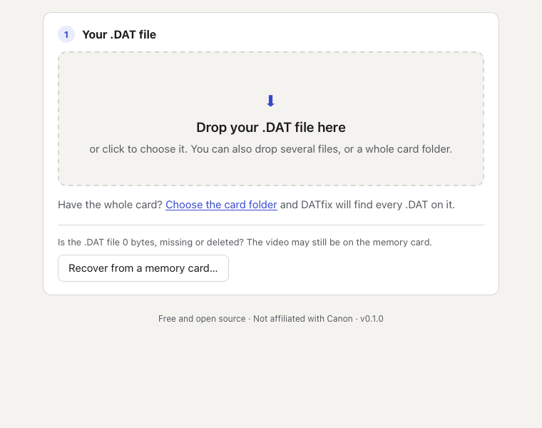
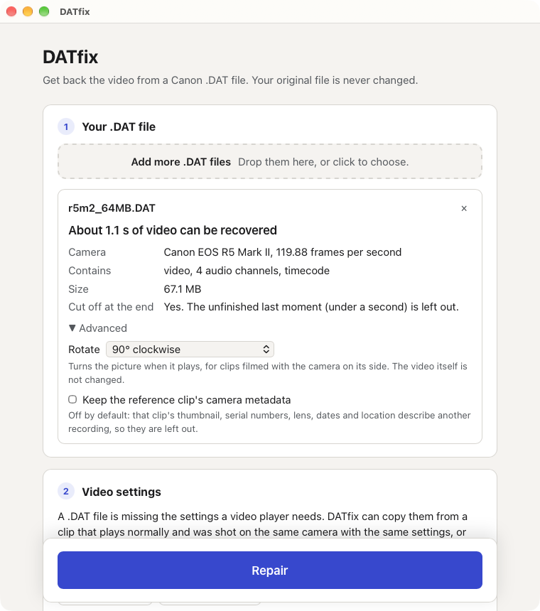
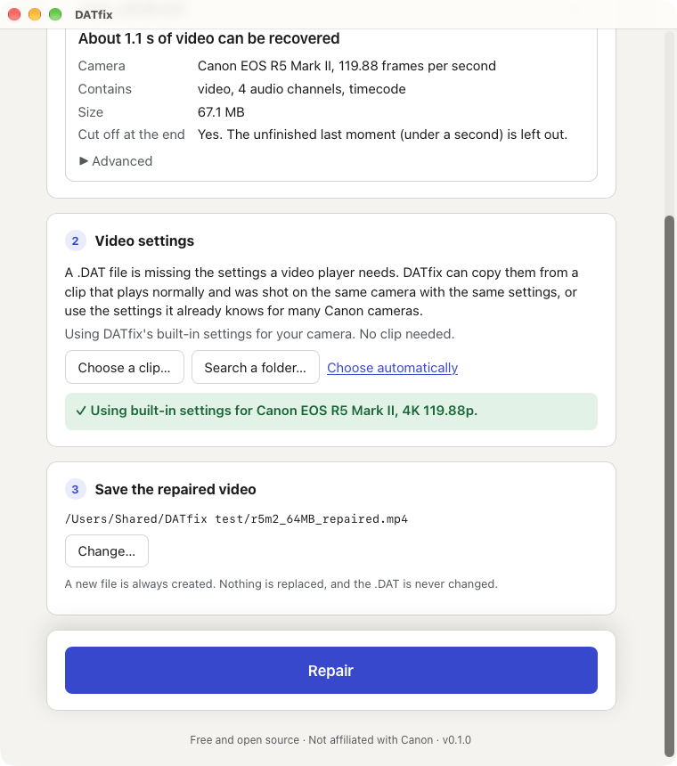
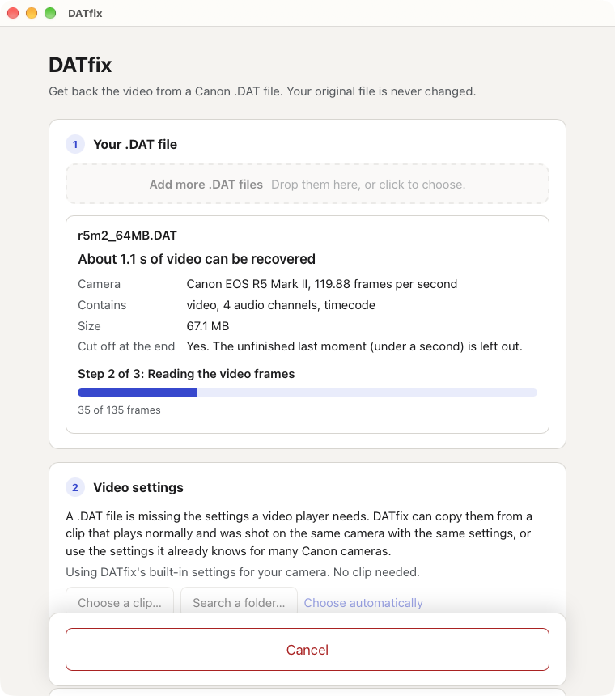
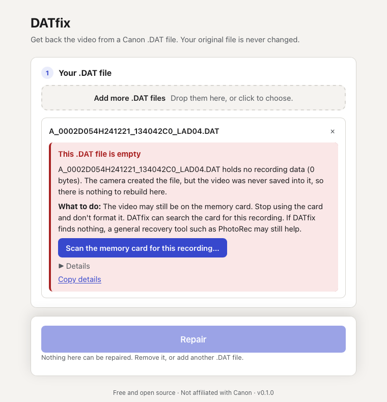
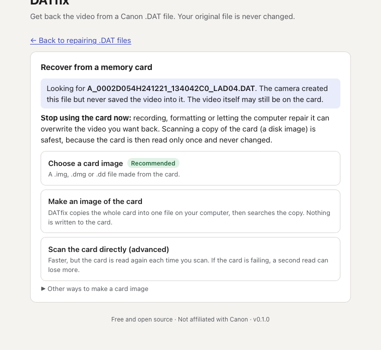
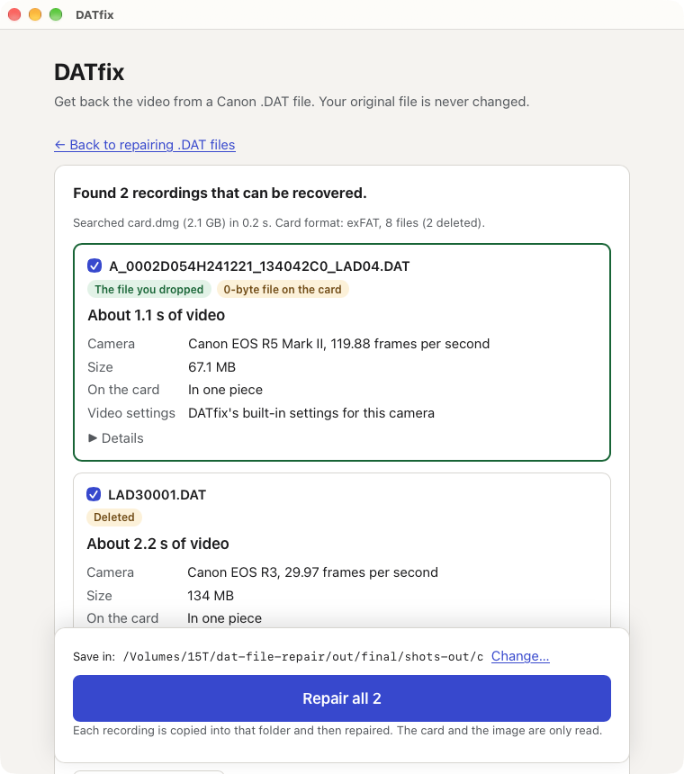

# DATfix user guide: how to repair a Canon `.DAT` file

**Your Canon camera left a `.DAT` file instead of an `.MP4` because the recording was cut off: the
battery died, the card was removed, or the camera stopped with an error such as Err 70.** DATfix
repairs that `.DAT` into a new `.MP4` you can play and edit, on your own computer, with no
re-encoding.

Your `.DAT` is only read. DATfix never changes or deletes it. DATfix is verified on the Canon EOS
R5 Mark II, EOS R5 and EOS R3. The [supported cameras](../../README.md#supported-cameras) table
lists each mode and what it was tested with.

This guide covers:

1. [Before you start](#before-you-start)
2. [Repair with the app](#repair-with-the-app)
3. [Repair with the command line](#repair-with-the-command-line)
4. [Recover a 0-byte or missing `.DAT`](#recover-a-0-byte-or-missing-dat)
5. [The recording date](#the-recording-date)
6. [Troubleshooting](#troubleshooting)
7. [Common questions](#common-questions)

## Before you start

- **Copy the card to your computer.** Copy the whole card folder, not only the `.DAT`. The healthy
  clips next to it can help the repair. Reading from the internal drive is faster and safer than
  reading from the card.
- **Keep the card as it is** until your video is back. Do not record on it or format it.
- **Check free space.** The repaired video is about as big as the `.DAT`.

Where to find the `.DAT`: in the folder where the camera saves its clips, usually under `DCIM`
(for example `DCIM/100CANON/`), or under `XFVC` for XF-HEVC S recordings. The name looks like the
camera's normal clips, for example `LAD12345.DAT` or `A_0012C345H250101_120000AB.DAT`.

## Repair with the app

### 1. Add the file

Open DATfix. Drop the `.DAT` file into the window, or click the drop zone and choose it.



If the `.DAT` is 0 bytes, missing or deleted, click **Recover from a memory card…** instead. See
[Recover a 0-byte or missing `.DAT`](#recover-a-0-byte-or-missing-dat).

You can add several `.DAT` files at once. To repair everything on a card, click
**Choose the card folder** under the drop zone. DATfix finds every `.DAT` on it.

DATfix reads the file. For a large file this takes up to a minute. It then shows:

- **Camera**: the model, or a family guess such as "Canon EOS camera with PCM audio".
- **Contents**: video, sound, number of audio channels, timecode.
- **About … of video can be recovered**: the length DATfix found.
- **Cut off at the end**: "Yes" means the camera stopped in the middle of a group. DATfix leaves
  out that unfinished last moment, which is under one second.


### Advanced options

Each file has an **Advanced** section under its summary. Most people never need it.

- **Rotate**: turns the picture when it plays. Use it for a clip filmed with the camera on its
  side. Choose **90° clockwise**, **180°** or **90° counter-clockwise (270°)**. **None** keeps the
  orientation of the reference clip (upright with the built-in settings). Only a display flag is
  written; the video itself is not changed, so an editor can still undo it.
- **Keep the reference clip's camera metadata**: off by default. A healthy clip used for the video
  settings also holds its own thumbnail, camera and lens serial numbers, owner, dates and location.
  These describe that other recording, so DATfix leaves them out. Turn this on only if you need
  them in the repaired file.



### 2. Video settings

DATfix needs the camera's decoder settings to rebuild the video. By default it finds them for you.
It looks for a matching healthy clip in the `.DAT`'s folder (or the whole card, if the `.DAT` is on
a card). If no clip matches, it uses its built-in settings for your camera mode.

The step shows which source it chose, for example
"Using DATfix's built-in settings for your camera. No clip needed." or
"Using the clip you chose: LAD12344.MP4."



To choose yourself:

- **Choose a clip…**: pick one healthy `.MP4` from the same camera, recorded with the same
  resolution, frame rate and sound settings. A clip shot just before or after is best.
- **Search a folder…**: DATfix checks every clip in that folder and its subfolders, and lists
  why each one does or does not fit.
- **Try without a reference** or **Use built-in settings instead**: use the built-in settings
  only.
- **Choose automatically**: go back to the default.

A clip you choose always wins over the built-in settings. If only its video fits, DATfix uses its
video settings and rebuilds the audio and timecode tracks. It tells you when it does this.

### 3. Save and repair

By default the repaired video goes next to the `.DAT`, named `<name>_repaired.mp4`. DATfix never
replaces an existing file; it adds `(2)`, `(3)` and so on. To pick another place, choose a folder
or a file name in step 3.

Press **Repair**. The progress bar shows the three steps: checking the settings, reading the video
frames and writing the repaired video. You can stop at any time. A stopped repair leaves no partial
file behind.



When it finishes, DATfix shows "Your video is repaired." and the recovered length. Click
**Show in Finder** (macOS) or **Show in Explorer** (Windows) to find the file.

Open **Details** under the result to see:

- the recording time written into the file, and where it came from (see
  [The recording date](#the-recording-date));
- the rotation, when you chose one;
- what DATfix left out from the reference clip for privacy;
- technical notes, for example how much of an unfinished last moment was dropped.


### Leftover files from a stopped repair

If DATfix or your computer stopped during a repair, a hidden unfinished file may be left in the save
folder. DATfix finds these and offers to delete them ("Found 1 unfinished file …"). They cannot be
played. Deleting them is safe.

## Repair with the command line

The command is `datfix`. Each command prints plain words first and the technical detail below.
Add `--json` to any command for newline-delimited JSON events.

### See what is in a `.DAT`

```sh
datfix inspect LAD12345.DAT
```

It lists the streams, the sample counts, an estimate of the duration and whether the file is cut
off.

### Repair

```sh
datfix repair LAD12345.DAT
```

This writes `LAD12345_repaired.MP4` in the current folder. Without a reference option, DATfix
first tries the clips in the `.DAT`'s own folder, then its built-in settings.

| Option | What it does |
|---|---|
| `--reference <clip.MP4>` | Use this healthy clip from the same camera. It always wins over the built-in settings. |
| `--reference-dir <folder>` | Search this folder, 3 levels deep, for a matching camera-original clip. Re-encoded files are skipped. |
| `--builtin` | Use the built-in settings only. |
| `-o, --output <file>` | Where to write the MP4. |
| `--force` | Replace the output file if it exists. |
| `--rotate <degrees>` | Turn the picture clockwise when it plays: 0, 90, 180 or 270. Default: the reference clip's orientation (upright with the built-in settings). |
| `--keep-reference-metadata` | Copy the reference clip's own metadata (thumbnail, serial numbers, owner, dates, location). Off by default. |
| `--stop-on-read-error` | Stop at the first unreadable part of a failing card instead of skipping it. |

Examples:

```sh
datfix repair LAD12345.DAT --reference LAD12344.MP4 -o ~/Movies/ceremony.MP4
datfix repair A_0012C345.DAT --reference-dir /Volumes/EOS_DIGITAL
```

### List the built-in settings

```sh
datfix profiles
```

Each profile holds decoder settings only: no video, thumbnails or location data.
`datfix profiles harvest <folder>` builds a new set from your own healthy camera clips.

### Remove leftovers from a stopped repair

```sh
datfix clean            # list hidden unfinished files in the current folder
datfix clean ~/Movies --yes   # delete them
```

## Recover a 0-byte or missing `.DAT`

A `.DAT` of 0 bytes holds no video, and some cards show no `.DAT` at all after a cut. The
recording is often still on the card, outside any file. DATfix can search the whole card and find
it by its content. The app and the command line (`datfix scan`) do the same search.

### 1. Stop using the card

Do not record on it, format it, or let the computer or camera "repair" it. Each write can overwrite
your video.

### 2. Search the card with the app

Click **Recover from a memory card…** on the first screen. If you added a 0-byte `.DAT`, DATfix
shows "This .DAT file is empty" with a **Scan the memory card for this recording…** button; it
opens the same screens and tells you which file it is looking for.



Choose how to read the card:

- **Choose a card image** (recommended): a raw image you already made (`.img`, `.dmg`, `.dd`).
- **Make an image of the card**: DATfix copies the whole card into one file on your computer,
  then searches the copy. Nothing is written to the card. On a Mac this asks for your password,
  because only administrators may read a whole card.
- **Scan the card directly (advanced)**: faster, but the card is read again for every scan.



DATfix lists each recording it finds: the name it had on the card (when the card's file list
still knows it), a badge such as **Deleted** or **0-byte file on the card**, the camera, the length
and whether it is in one piece. Choose where to save, then press **Repair all**. DATfix copies
each recording off the card into that folder, repairs it with the normal flow, and uses finished
clips from the same card for the video settings when they fit.



A recording keeps its original name, also when its card entry has 0 bytes: DATfix matches the
entry by the start time in its name (or its creation time) against the recording's timecode. The
repaired video then gets its date from that name or from the card's file list, not from the time
of the scan.

### 3. Or use the command line

Make a raw image first. The scan only reads, but an image protects you if the card fails during a
second read.

**macOS, Disk Utility:**

1. Insert the card. In Disk Utility, choose **View > Show All Devices**.
2. Select the card **device** (the top line, not the volume under it).
3. Choose **File > New Image > Image from "…"**.
4. Set **Format** to **DVD/CD master** (or **read/write**). Compressed images do not work.
5. Save it to a drive with enough free space (as large as the card).

**macOS, Terminal:**

```sh
diskutil list                                 # find the card, for example disk4
diskutil unmountDisk disk4
sudo dd if=/dev/rdisk4 of=card.img bs=4m status=progress
```

Check the disk number twice. `dd` reads from `if=` and writes to `of=`.

**Windows:** use a raw imaging tool, for example HDD Raw Copy, or `dd` in Git Bash. The card is a
device such as `\\.\PhysicalDrive2`. Save a raw image (`.img`), not a compressed one.

**Linux:** `sudo dd if=/dev/sdX of=card.img bs=4M status=progress conv=noerror,sync`. For a
failing card, use `ddrescue`.

Then scan the image:

```sh
datfix scan card.img                          # report only
datfix scan card.img -o recovered             # save each recording as a .DAT
datfix scan card.img -o recovered --repair    # also repair each one to an MP4
```

Saved recordings keep their name from the card (`LAD12345.DAT`) when it is known. Otherwise, or
when two recordings would get the same name, they are named `recovered_<offset>.DAT`.

`--repair` uses finished clips from the same card as references, then the built-in settings.

| Option | What it does |
|---|---|
| `--clips` | Also save every finished Canon clip found, including deleted ones. |
| `--fragments` | Also save pieces of recordings whose start is gone. |
| `--no-stitch` | Do not join recordings that the card split into pieces. |

`<offset>` in a file name is the byte position on the card where the recording starts.

The scan finds a recording only while its data has not been overwritten. It cannot find recordings
from the EOS R or M50 Mark II. It reads raw images and exFAT/FAT32 cards; convert a compressed
`.dmg` first with `hdiutil convert -format UDTO in.dmg -o out`. Full details:
[card scanning](../format/card-carving.md).

If DATfix finds nothing, a general recovery tool such as [PhotoRec](https://www.cgsecurity.org)
may still help. Open the `.DAT` or `.MP4` files it finds in DATfix.

## The recording date

A repaired file carries the time the recording started, so editors and photo apps sort it
correctly. A `.DAT` holds no date of its own, so DATfix takes it from the first of these that it
has. The result's **Details** (and the command line's `recorded:` line) say which one:

| Details says | Where the time comes from |
|---|---|
| Recording time from the file name | A Canon file name that holds the date and time, such as `A_0002D054H241221_134042C0.DAT` (21 December 2024, 13:40:42). |
| Recording time from the memory card's list of files | Card recovery only: the time the camera created the file, from the card's file list. |
| Recording time from the camera's timecode, with the date from the file's date | The timecode gives the time of day; the `.DAT`'s own file date gives the day. |
| Recording time estimated from the file's date | The time the `.DAT` was last saved, minus the recording's length. |
| Recording time unknown | Nothing gives a time. Set the date in your editor. |

A camera with a wrong clock, or a timecode preset to another value, gives a wrong date. A `.DAT`
copied with a tool that does not keep file dates also loses the day. Fix the date in your editor.

## Troubleshooting

Each error in the app has a title, what happened, and **What to do**. **Copy details** copies the
technical text for a bug report. The command line prints the same words.

### This .DAT file is empty

The `.DAT` holds no recording data. The camera created the file but never saved the video into it.
Click **Scan the memory card for this recording…** and follow
[Recover a 0-byte or missing `.DAT`](#recover-a-0-byte-or-missing-dat).

### DATfix can't read this recording yet

The video settings fit, but the camera arranged the video inside the `.DAT` in a way DATfix does
not understand yet. This is a gap in DATfix, not a problem with your clip, so another clip will not
help. Keep the `.DAT` unchanged. Click **Report this recording…** (or open the
[report form](https://github.com/lelanddutcher/dat-file-repair/issues/new?template=unreadable-recording.yml))
and paste the text from **Copy details**.

### This file can't be repaired

The file has no Canon recovery index. Check that it is the `.DAT` from a Canon camera card, and
that it copied completely.

### This isn't a Canon camera .DAT

The file is from a Video CD, a DVD recorder or another device. These `.dat` files are not broken.
Open them in VLC, or rename an MPEG one to `.mpg`.

### This camera's .DAT can't be repaired yet

The file comes from a Canon camera that writes no recovery index, such as the EOS R or M50 Mark II.
Keep the `.DAT` unchanged and
[share a sample](https://github.com/lelanddutcher/dat-file-repair/issues/new/choose) so a later
version can support it.

### DATfix needs a healthy clip from this camera

DATfix has no built-in settings for this mode. Choose one clip that plays normally, from the same
camera, with the same resolution, frame rate and sound settings. Then please send a camera report so
the next version includes this mode.

### DATfix needs a healthy clip to be sure

More than one set of built-in settings fits, and the video alone cannot tell which is right.
Choose a healthy clip from the same camera and mode.

### The clip doesn't match this .DAT

The clip was recorded with different settings. The screen lists each difference. Choose another
clip from the same camera and mode, or repair without a clip.

### No matching clip found

None of the clips in the folder was recorded with the same settings. The screen lists why each one
was skipped. Choose a clip from the same camera and mode, or use the built-in settings.

### The healthy clip can't be read

The clip does not open as a video. It may be damaged or still copying. Choose a clip that plays.

### A file with that name already exists / That would overwrite the original

DATfix never replaces files and never writes to the `.DAT`. Choose another name or folder.

### The save folder is gone

The save folder was removed or the drive was disconnected. Choose another place to save.

### Not enough free space / The disk is full

The repaired video needs about as much space as the `.DAT`. Free up space or save to another
drive. If the disk filled during the write, DATfix removed the partial file.

### No permission

DATfix cannot read or write in that place. A locked card or a read-only folder causes this. Choose
another folder. On a Mac, check **System Settings > Privacy & Security > Files and Folders**.

### File not found

The card or drive was removed. Reconnect it and add the file again.

### The file ended early

The file is shorter than expected. It may still be copying. Wait for the copy to finish.

### The card or disk reported a read error

Part of the file could not be read. Copy the `.DAT` to your computer's internal drive first (a
card recovery tool can help), then repair the copy.

### A disk error stopped the job

The operating system reported a read or write error. Check that the card or drive is connected and
has free space, then try again.

### This is a folder

You dropped a folder where DATfix expected a `.DAT`. Drop the `.DAT` itself, or use
**Choose the card folder**.

### No .DAT files were found there

The folder you chose has no `.DAT` files. A `.DAT` is what a Canon camera leaves when a recording is
cut off. If the card shows none, see [Recover a 0-byte or missing `.DAT`](#recover-a-0-byte-or-missing-dat).

### Stopped

You stopped the repair. No partial file was left. Press **Repair** to start again.

### Something went wrong inside DATfix

This is a bug. Click **Copy details** and paste the text into a
[bug report](https://github.com/lelanddutcher/dat-file-repair/issues/new/choose).

### The repaired file shows the wrong date

See [The recording date](#the-recording-date) for where the date comes from. **Details** under the
result says which source DATfix used. DATfix never copies the reference clip's dates, thumbnail,
serial numbers or location unless you turn on **Keep the reference clip's camera metadata** (or
pass `--keep-reference-metadata`).

## Common questions

### How do I open a `.DAT` file from my Canon camera?

You cannot open it directly. Repair it with DATfix, then open the new `.MP4`. Renaming the `.DAT`
to `.MP4` does not work, because the file's index is missing.

### My battery died while recording. Can I get the video back?

Usually yes. The `.DAT` holds everything up to the cut. DATfix leaves out only the unfinished last
moment, which is under one second.

### I removed the card while recording. What now?

Put the card in your computer and look for the `.DAT`. If it has a size, repair it. If it is
0 bytes or missing, follow [Recover a 0-byte or missing `.DAT`](#recover-a-0-byte-or-missing-dat).
Do not record on the card until your video is back.

### Does DATfix upload my video?

No. It runs on your computer and works without an internet connection.

### Is DATfix free?

Yes. It is free and open source under the MIT license, with no trial, watermark or size limit.

### Which editors open the repaired file?

Repaired files open in QuickTime and DaVinci Resolve 21.2 with all tracks and the camera's
timecode. Premiere Pro and Final Cut Pro are not tested yet.

Not affiliated with or endorsed by Canon Inc. Canon and EOS are trademarks of Canon Inc.
